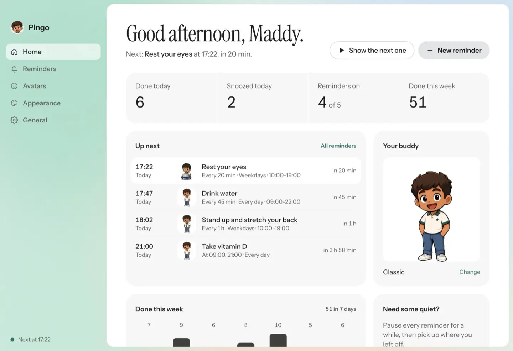
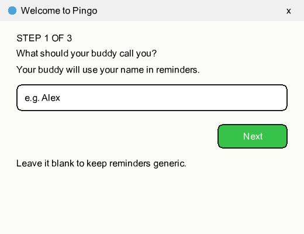
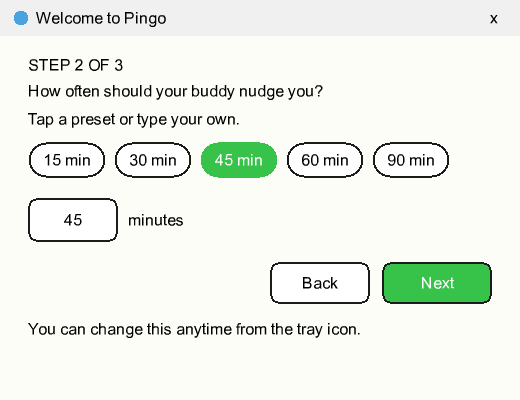

<p align="center">
  
</p>

<h1 align="center">Reminders that walk in.</h1>

<p align="center">
  <b>Pingo</b>, your little buddy for Mac and Windows.
</p>

<p align="center">
  <a href="https://pingo-flax.vercel.app"></a>
  <a href="https://pingo-flax.vercel.app"></a>
</p>

<p align="center">
  <a href="https://github.com/MadhavanAR/Pingo/actions/workflows/ci.yml"></a>
  <a href="https://github.com/MadhavanAR/Pingo/releases/latest"></a>
  <a href="LICENSE"></a>
</p>

<p align="center">
  
  
  
  
  
</p>

---

A little character walks onto your screen to remind you to drink water, stretch,
rest your eyes or take your medicine. Press **Done** and it celebrates. Press
**Snooze** and it comes back later. Then it walks off and gets out of your way.


### Water. Stretch. Rest eyes. Medicine. Your own.

- **As many reminders as you like.** Each has its own schedule, days, hours,
  snooze length and character.
- **On your schedule.** Every _N_ minutes (1 minute to 12 hours) inside the
  hours you choose, or at set times of day, on the days you pick.
- **Your character.** Classic, ID badge or sticker, or make your own from any
  image or **animated GIF**. Backgrounds are cut out automatically.
- **Your look.** A modern or retro pixel speech bubble, six accent colours,
  character size, either bottom corner, an optional sound, auto-snooze.
- **A home for it all.** One window shows what's next, today's done and
  snoozed counts and the week, and holds every setting.
- **Private.** No accounts, no telemetry, no network access.
- **Free and open source.** MIT licensed. Also runs on Linux.

<p align="center">
  
</p>

## Install

**Two steps. Thirty seconds.** Get it from
**[pingo-flax.vercel.app](https://pingo-flax.vercel.app)**, which picks the right
installer for you, or from the
[latest release](https://github.com/MadhavanAR/Pingo/releases/latest).

<table>
<tr>
<th width="50%">Mac</th>
<th width="50%">Windows</th>
</tr>
<tr>
<td valign="top">

**1. Drag to Applications.** Open `Pingo-mac-arm64.dmg` (Apple Silicon) or
`Pingo-mac-x64.dmg` (Intel) and drag Pingo into Applications.

**2. Open Pingo.** First launch only: **System Settings → Privacy & Security →
Open Anyway**.

</td>
<td valign="top">

**1. Run the installer.** Open `Pingo-Setup-<version>.exe` from your Downloads
and click through. It takes a few seconds.

**2. Allow it, once.** If Windows shows a blue warning, click **More info →
Run anyway**.

</td>
</tr>
</table>

Builds are not code-signed yet, which is why step 2 is there. On Linux, make the
`.AppImage` executable or run `sudo apt install ./Pingo-*.deb`.

On first launch, a short three-step setup asks for your name, what to remind you
about, how often, and a character.

<p align="center">
  
  
</p>

## Usage

Right-click the tray icon for:

| Menu item        | Action                                                    |
| ---------------- | --------------------------------------------------------- |
| Next: …          | What's coming up (or how long Pingo is paused)            |
| Remind me now    | Show the next reminder immediately                        |
| Open Pingo…      | The control center: Home, Reminders, Avatars, Appearance  |
| New reminder…    | Start a new reminder                                      |
| Avatars…         | Pick a character or make your own                         |
| Pause / Resume   | 30 min, 1 hour, 2 hours, until tomorrow, or until resumed |
| Start at login   | Launch automatically (installed builds)                   |
| Run setup again… | Re-open the first-launch wizard                           |

### Control center

| View       | What's there                                                           |
| ---------- | ---------------------------------------------------------------------- |
| Home       | What's next, done and snoozed today, the last seven days, pause        |
| Reminders  | Every reminder with an on/off switch; templates; an editor for each    |
| Avatars    | Bundled and your own characters; the avatar studio for images and GIFs |
| Appearance | Bubble style, accent, size, corner and screen, sound, auto-snooze      |
| General    | Your name, pause, start at login, setup, about                         |

Every change saves itself. Each reminder has a **Show it on my screen** button
that previews it without touching the schedule.

### Reminder defaults

| Setting      | Default          | Notes                                              |
| ------------ | ---------------- | -------------------------------------------------- |
| Kind         | Drink water      | Or stretch, eyes, posture, medicine, custom text   |
| When         | Every 45 minutes | 1 minute to 12 hours, or up to 12 set times a day  |
| Days         | Every day        | Any combination                                    |
| Active hours | 10:00–23:00      | Your time zone; can wrap past midnight, or all day |
| Snooze for   | 10 minutes       | 1 to 120 minutes                                   |

Up to 50 reminders and 24 custom avatars. To draw your own character with an AI
image tool, see [Make your own character](docs/make-your-own-character.md).

## Troubleshooting

- **The character never appears.** Every-few-minutes reminders only show during
  their active hours (10:00 to 23:00 by default) and on their days. Check the
  reminder in **Open Pingo… → Reminders**, or press **Show it on my screen**.
- **No welcome screen after upgrading.** Your settings were kept. Use **Run setup
  again…** from the tray.
- **An imported character shows as a rectangle.** The source image needs a plain,
  solid-colour background; raise **Strength** in the avatar studio. GIFs are kept
  as they are, so use one with a transparent background.
- **Start at login when running from source (Windows).** Run
  `npm run autostart:enable`, or `npm run autostart:disable` to undo.

## Development

Requirements: Node.js 22+ (see `.nvmrc`).

```bash
git clone https://github.com/MadhavanAR/Pingo.git
cd Pingo
npm install
npm start
```

| Command                            | Purpose                                     |
| ---------------------------------- | ------------------------------------------- |
| `npm start`                        | Run the app from source                     |
| `PINGO_USER_DATA=/tmp/p npm start` | Run from source with a throwaway profile    |
| `npm run check`                    | Lint, format check and unit tests (CI gate) |
| `npm test`                         | Unit tests only                             |
| `npm run lint:fix`                 | Auto-fix lint issues                        |
| `npm run format`                   | Format all files with Prettier              |
| `npm run dist:win`                 | Build the Windows installer into `dist/`    |
| `npm run dist:mac`                 | Build the macOS DMG (run on macOS)          |
| `npm run dist:linux`               | Build AppImage and .deb                     |

The codebase layout and design decisions are described in
[docs/ARCHITECTURE.md](docs/ARCHITECTURE.md).

### Defaults

Defaults and limits live in [`src/main/settings.js`](src/main/settings.js)
(appearance and name) and [`src/main/reminders.js`](src/main/reminders.js)
(each reminder). Fixed timings, such as the poll
interval, are in [`src/main/config.js`](src/main/config.js).

## Releasing

Releases are built by [GitHub Actions](.github/workflows/release.yml) for all
three platforms when a version tag is pushed:

```bash
npm version minor        # bumps package.json and creates the tag
git push --follow-tags
```

The workflow fails if the tag does not match `package.json`. Update
[CHANGELOG.md](CHANGELOG.md) before tagging.

## Website

`website/` is the landing page at
[pingo-flax.vercel.app](https://pingo-flax.vercel.app): static HTML, CSS and
vendored GSAP, with no build step. It deploys to Vercel,
GitHub Pages, Hostinger, AWS S3/CloudFront or any static host. See
[docs/DEPLOYMENT.md](docs/DEPLOYMENT.md).

## Contributing

Contributions are welcome. Please read [CONTRIBUTING.md](CONTRIBUTING.md) and the
[Code of Conduct](CODE_OF_CONDUCT.md). To report a vulnerability, follow
[SECURITY.md](SECURITY.md).

## License

[MIT](LICENSE). The bundled fonts are licensed under the
[SIL Open Font License 1.1](assets/fonts/OFL.txt).

<p align="center">
  <br />
  <sub>Designed and built by <a href="https://www.linkedin.com/in/madhavanar/">Madhavan</a>.</sub>
</p>
